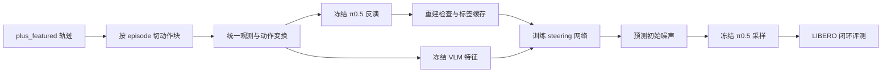

**用 plus_featured 训练 π0.5 的 FlowDAgger 适配方案**

核查日期：2026-10-29。本文根据本地 FlowDAgger、其内置 openpi、LIBERO-Recovery 的代码及 plus_featured 的实际清单编写。本次完成代码分析、数据窗口统计和方案设计；未修改训练实现、安装依赖、加载模型或启动训练。下文标明“拟新增”的文件与命令尚未实现。

**可行，建议先做冻结 LIBERO π0.5 的离线 steering 训练。** 使用 `pi05_libero` 作为基座，将示范动作反演成采样初始噪声，再训练 FlowDAgger 的小网络预测该噪声。现有 `train_flowdagger.py` 是 MetaWorld 在线流程，不能仅更换数据路径就训练。反演器、steering 网络及 BC 更新可以复用，数据读取、观测接口、离线训练入口和 LIBERO 评测需要新增适配。

如果“训练 pi05”指修改 π0.5 本身的权重，则应另做 SFT；它和 FlowDAgger 的训练目标不同。推荐将 SFT 作为对照或基座能力不足时的前置阶段。

| 方案 | 实际更新的参数 | plus_featured 的用法 | 当前可行性与用途 |
|---|---|---|---|
| A：离线 FlowDAgger steering，优先实现 | 小型 steering 网络；π0.5 冻结 | 动作反演为 latent 标签，监督小网络 | 不需要在线专家；最接近本次希望复用的方法核心 |
| B：π0.5 SFT | π0.5 全参或单独配置的 LoRA 参数 | 直接监督动作流匹配 | 需接入 openpi 数据加载；用于对照，不能称为同一训练方法 |
| C：Standard SFT → 冻结 → Recovery steering | 分阶段更新基座和小网络 | 先学常规任务，再学恢复；steering 可混入 Standard 防止常规性能下降 | 当 LIBERO 基座在所选任务上能力不足时采用；需重新生成全部 latent/特征缓存 |
| D：完整在线 FlowDAgger | steering 网络，基座冻结 | 离线数据作初始化，再收集在线纠正 | 缺少覆盖十任务及失败状态的可靠专家，当前不能由固定数据集直接补足 |

“离线 FlowDAgger steering”在本文是适配方案名称，不表示已经复现原论文的在线数据聚合实验。示范文件里的下一步动作只对对应示范状态有效，不能在策略偏离后继续播放并称为在线专家。

**现有方法的核心是噪声监督，而不是动作 BC。**

设冻结的 π0.5 采样器为 `Fθ(o,z)`，归一化后的专家动作块为 `ā`。先求 `z* ≈ Fθ⁻¹(o,ā)`，再学习 `gφ(o)`，使 `MSE(gφ(o),z*)` 尽可能小；执行时使用 `Fθ(o,gφ(o))`，反归一化后发送给环境。使用压缩基底时，监督目标改为噪声系数，执行前先展开。



| 已阅读的核心代码，路径相对 FlowDAgger | 作用 | 适配判断 |
|---|---|---|
| `flowdagger_pi05/train_flowdagger.py:56,81` | 定义输入维度、加载基座、创建 MetaWorld 环境和专家 | 新增离线入口；不直接复用整个 `main()` |
| `flowdagger_pi05/dagger_loop.py:117` | 在线采集、入库、BC 更新、评测 | 离线版本只复用训练思路，去掉依赖采集的停止条件 |
| `flowdagger_pi05/action_converter.py:17` | 环境动作与模型归一化动作互转 | 显式传入 LIBERO 参数，并与 openpi transforms 对齐 |
| `flowdagger_pi05/flow_matching_inverter.py:97,560` | Euler 离散采样反演、逐步定点迭代等 | 优先复用 `perstep_fp`，独立加入验收和缓存 |
| `flowdagger_pi05/train_utils.py:60,88,113` | DCT 基底及噪声投影/展开 | 首版 `K=H=10`，绕过压缩；必须显式传 H |
| `flowdagger_pi05/train_utils.py:199,230,251` | MetaWorld 观测封装、SigLIP/VLM 特征 | 新增双相机封装；优先 VLM 特征 |
| `flowdagger_pi05/steering_policy.py:47,85` | `mode()` 对 latent 标签做 MSE，Adam 更新 | 可以复用；它不更新 π0.5 参数 |
| `flowdagger_pi05/buffer.py:97` | `Dataset`、采样及在线 replay buffer | 离线实现独立索引/采样；不需要奖励和 next_obs 副本 |
| `flowdagger_pi05/openpi/src/openpi/training/config.py:283,800` | LIBERO 数据变换、`pi05_libero` 配置 | 确定 H=10、无额外 delta 变换、quantile norm |
| `flowdagger_pi05/openpi/src/openpi/policies/libero_policy.py` | 双相机、8D state、7D 动作输出 | 直接采用其输入输出约定 |
| `flowdagger_pi05/openpi/src/openpi/policies/policy.py:25,69,122` | 指定 noise 推理、提取 VLM prefix | 训练/评测共用同一模型对象与 transforms |
| `flowdagger_pi05/openpi/examples/libero/main.py` | 原生 LIBERO reset、相机、姿态、动作队列 | 新评测器的环境接口参考 |
| `shared/task_configs.py`、`shared/experts/libero_expert.py` | 示例任务、基于特权状态的抓放专家 | 没有十任务完整专家；抽屉、堆叠和复合恢复不能据此视为已支持 |

本地 `reproduction_filters.py` 和 `docs/reproduction_20261028_auto/` 还记录了反演拒绝样本错误入库、双缓冲语义、checkpoint 恢复等检查。新流程应保留这些修正的目的，但不用把 MetaWorld 的整条包装链迁移过来。

**基座必须匹配 LIBERO 的机器人和动作接口。**

首选 `openpi_config=pi05_libero`，权重候选为内置 openpi README 列出的 `gs://openpi-assets/checkpoints/pi05_libero`。现有 MetaWorld 的 `mmurray-ms/pi05-metaworld` / `pi05_metaworld` 是单相机、4D 动作的另一种任务分布，不能通过补成 7 维就替代 LIBERO 基座。

本次只核查了仓库提供的配置与权重地址，没有下载或验证该权重在本机的可加载性。实施时必须确认使用 JAX `params/` 权重及其 `assets/`，不能把 StarVLA 的 `.pt` / `.safetensors` 直接交给现有 NNX 反演器。

注意两个不同用途的路径：`pi05_libero` 配置里的 `weight_loader` 指向 `pi05_base/params`，是原始 LIBERO SFT 的初始化；本次冻结 steering 的基座应显式加载已经训练过的 `pi05_libero`。不能因配置名称相同就误用通用 `pi05_base`。

openpi 的公开结果表覆盖 Spatial、Object、Goal、LIBERO-10；plus_featured 有八个 LIBERO-90 任务。仅凭公开四套结果，不能推断该基座对这八个任务的能力或断言它从未见过相关任务。因此先测十任务的 Base 常规成功率和恢复成功率，再决定是否需要方案 C。

**数据本身可以直接读取 NumPy，无须先转 LeRobot。**

数据根目录为 `/home/dais/workspace/LIBERO-Recovery/datasets/plus_featured`。先读 `data_pool.json` 的 `standard.records` 和 `recovery.records`，每条记录的路径是：

```text
<dataset_root>/<cache_root>/<record.source>/<record.episode_index:06d>/
  images.npy
  state.npy
  actions.npy
```

`cache_root` 当前为 `data/cache`。外层来源类别是 Standard/Recovery，而目录中的 `source` 有 `original`、`standard_native`、`recovery` 三种，不能硬编码成 `data/cache/standard`。episode 标识至少使用 `(source, episode_index)`，另存原仓库、revision、source_file、source_demo 等溯源字段。

| 本地任务编号 | 任务 | Standard 轨迹 | Recovery 轨迹 | 总帧数 | Standard 完整窗口 | Recovery 完整窗口 |
|---|---|---:|---:|---:|---:|---:|
| 0 | 前方黑碗放到盘子上 | 50 | 40 | 12,886 | 668 | 585 |
| 1 | 打开上层抽屉并放入碗 | 50 | 25 | 18,486 | 973 | 837 |
| 2 | 番茄酱放入上层抽屉 | 50 | 25 | 19,784 | 1,030 | 917 |
| 3 | 打开底层抽屉 | 50 | 20 | 10,584 | 694 | 332 |
| 4 | 前方黑碗叠到中间黑碗上 | 50 | 20 | 10,567 | 614 | 406 |
| 5 | 摩卡壶放到炉灶上 | 50 | 25 | 14,941 | 731 | 729 |
| 6 | 白色马克杯放到盘子上 | 50 | 20 | 10,430 | 767 | 246 |
| 7 | 前方黄油放入上层抽屉并关闭 | 50 | 20 | 19,655 | 878 | 1,055 |
| 8 | 葡萄酒瓶放到酒架上 | 50 | 33 | 17,177 | 856 | 821 |
| 9 | 奶油奶酪放入篮子 | 50 | 90 | 25,234 | 694 | 1,764 |
| 合计 | 十任务 | **500** | **318** | **159,744** | **7,905** | **7,692** |

窗口统计为 H=10、stride=10、只取完整窗口：每 episode 为 `floor(T/10)`，总计 **15,597**。这是全量数据、未分训练验证集、未过滤反演误差时的数量，不是最终训练样本量。所有现有 episode 均至少有 10 帧。逐任务结果见同目录 `plus_featured_pi05_窗口统计.csv`。

为防止漏掉恢复成功前的末尾动作，正式训练可采用 `tail=last_full`：若 T 不是 10 的倍数，再加入起点为 `T-10` 的完整窗口，并去重。这样不伪造 padding 动作，合计 **16,336** 个窗口（Standard 8,358；Recovery 7,978），末尾窗口会与前一窗口重叠。两种策略都可行，应在配置和缓存中明确区分。若改 stride=1，则完整窗口数变为 152,382，反演成本显著增加，不能沿用前述预算。

Recovery 的 318 条来自官方 Expert 中这些任务的多帧轨迹子集；Standard 的 500 条来自原生 LIBERO 示范。两者都是监督数据，Standard 不能被称为当前 π0.5 自主采集的成功轨迹。多帧过滤也不等于逐条恢复成功认证；没有成功标签时保留“未认证”，不能按 `filter_failures=1` 伪造成功标记。

**训练和评测必须共用以下数据约定。**

| 项目 | plus_featured / pi05_libero 的正确处理 | 现有流程需要调整之处 |
|---|---|---|
| 相机 | `images[t,0]` 为 agentview，`images[t,1]` 为 wrist；RGB uint8 | MetaWorld 只有 `observation/image`；新增 `observation/wrist_image` |
| 图像方向 | 缓存已经对齐训练/运行方向，读取后不再翻转 | 环境原始图像按 openpi LIBERO 示例旋转 180°，仅在环境边界执行一次 |
| 尺寸 | 缓存 256×256，共用 `resize_with_pad` 到模型 224×224 的路径 | 不用 steering 原始 CNN 的 128×128 参数替代基座输入尺寸 |
| 状态 | float32 8D：EEF xyz、axis-angle xyz、两指 qpos | `DummyEnv` 的 state_dim=4 改为独立 LIBERO 形状 8；不能把 axis-angle 当 Euler 角 |
| 动作 | float32 7D 原生 OSC_POSE 控制量 | 不能额外乘位移/角度尺度；`action_dim_env=7` |
| 夹爪 | -1=open，+1=close | Recovery 已做过 `1-2*a`；不得再反转或套 StarVLA open_gripper 二值化 |
| 文本 | 使用每条记录 `prompt`，即官方 `task.language` | 不能用全局 MetaWorld prompt、中文说明或任意 recovery 前缀 |
| 模型输入动作 | quantile Normalize 后补零到 32D | 真实控制维度只有前 7 维，但噪声/模型动作维度仍为 32 |
| 额外 delta | `extra_delta_transform=False`，converter 用 `delta_mask=None` | `ActionConverter` 默认 `(True,)*6+(False,)` 不适用于本次 π0.5 LIBERO 配置 |

提示词尤其要按 `task_key → official_task_language` 映射：奶油奶酪的缓存 prompt 是 `pick up the cream cheese and place it in the basket`，原 Recovery instruction / 某些 BDDL 写法没有 `up`；酒瓶 BDDL 还存在首字母大小写差别。训练、普通评测、恢复评测都应取同一清单里的规范文本，`raw_prompt` 只用于溯源。

`task_index=0..9` 是这个精选数据集的编号，不是 LIBERO suite 内的整数任务编号。用 `(suite, task_id/task_key)` 查找原生任务，不能直接 `suite.get_task(task_index)`。

State 还有一处容易误解的细节：本地 `pi05_libero` 是 `discrete_state_input=False`，而 `Pi0.embed_suffix()` 只在 `not self.pi05` 时加入连续 state token。因此该配置下基座并没有因为传入 8D state 就自动使用它作为内容条件。应保持原基座配置，同时让 steering 显式输入 8D state（现有 `add_states` 思路）；不要擅自切换 `discrete_state_input=True` 改变 checkpoint 的输入分布。8D state 仍需进入统一接口和正确的 norm/transforms。

**实现应把“模型接口”和“离线样本”从环境中拆出来。**

拟新增 `libero_pi05_bridge.py`，加载一次 JAX 模型，Policy 与 `FlowMatchingInverter` 共享参数。它统一提供：原始观测封装、模型输入变换、动作归一化/反归一化、VLM 特征提取、反演、指定 noise 推理。特征提取和反演都用 `train=False`，不随机增强图像。

动作变换以 `data_config.data_transforms → Normalize → model_transforms` 为标准。沿用 converter 时明确设置：

```python
ActionConverter(
    norm_stats_actions=norm_stats["actions"],
    norm_stats_state=norm_stats["state"],
    delta_mask=None,
    action_dim_internal=32,
    action_dim_env=7,
    action_horizon=10,
    pre_norm_scale=1.0,
    gripper_scale=1.0,
)
```

需要对实际 checkpoint 的 norm stats 做数值一致性检查。现有 converter 以“是否含 q01”推断 quantile 模式，openpi 则读取 `data_config.use_quantile_norm`；本次配置应使用 quantile，但新桥接层应显式断言，防止以后更换配置时静默错配。内部动作第 7..31 维应为 literal zero；现有 converter 已包含这项修正，保留即可。

冻结基座时必须沿用其 checkpoint assets 中的 state/action stats，而不是对 plus_featured 重新计算一套后替换。数据分布有差异应记录归一化值范围和异常比例；不要通过偷偷裁剪归一化目标“修好”反演。

多任务首选现有 `vlm_pi0`：它融合图像和 prompt，输出 2048D 特征，再与 8D state 一起送入 steering。`pixels` 可沿用 `(B,2048,1)`、`state` 用 `(B,8,1)`，目标 latent 是 `(B,10,32)`。首版保持原始 8D state 输入以贴近现有实现；若额外归一化 steering state，需作为独立配置并保存变换。

只用 `siglip_pi0` 或像素 CNN 的 steering 没有明确语言条件，多任务时应加 task embedding 或改用 VLM；十个单任务 steering 则没有这个歧义，建议先用单任务打通链路，再比较共享十任务网络。

VLM 特征当前对所有 prefix token 求 mean，没有显式排除 padding camera/text token。首版可保留这个实现以便对齐现有 FlowDAgger；mask-aware pooling 应单独版本化。另一个可选路径 `_extract_siglip_features()` 直接把 0..255 转成 float32 后送入视觉塔，绕过 `Observation.from_dict()` 的 [-1,1] 变换；如果使用该路径，应先对齐基座视觉预处理，不能照搬后默认其数值一致。

批量处理多任务时，逐样本完成文本和图像 transforms，再 stack 模型 Observation。当前 `Policy.infer/get_prefix_rep` 的已批量输入分支会广播非 image/state 字段，不能未经验证就假定它正确支持一个批次里不同的 prompt。第一版可逐条抽特征、以正确 stack 的 Observation 小批次反演。

**反演配置、动作窗口长度和执行步数是三个独立概念。**

| 参数 | 首轮建议 | 原因 |
|---|---|---|
| 模型动作长度 H | 10 | 来自 `pi05_libero`，不能沿用部分工具函数默认 50 |
| 内部动作/噪声维度 D | 32 | 取模型属性，7D 是环境动作维度 |
| 每次执行步数 Q | 首轮 10；随后统一比较 5 | 必须 `1 <= Q <= H`；恢复任务可能受益于更频繁重规划，但需实验确认 |
| 噪声基底数 K | 10 | K=H 时直接使用完整噪声，没有 DCT 压缩误差 |
| 采样积分步数 S | 10 | 与 `Pi0.sample_actions(num_steps=10)` 一致；S 不是 H |
| 反演方法 | `perstep_fp` | 保留现有逐步定点方法；初始每步迭代 5 次 |
| 积分器 | Euler | `perstep_fp` 反演的是离散 Euler；不要和 midpoint 解码混搭 |
| 动作尺度 | 1 | Native OSC 动作，不做额外尺度放大 |
| steering | VLM 2048D + state 8D，MLP 256×3、bottleneck 256 | 延续现有默认网络 |
| BC | Adam，lr=1e-4，batch=256 | 作为首轮起点；步数与采样量显式记录 |
| 输出范围 | 先诊断标签再确定；原实现 tanh ±3 | 记录超过范围的比例；不要静默裁剪反演标签 |

现有 `K=10` 在 H=50 的模型上代表压缩，在本次 H=10 模型上代表完整噪声。即使数字相同，含义也不同。所有 `_expand_noise_basis(..., action_horizon=H)` 调用均应显式传 H，配置启动时断言 `K<=H`。

标签质量应以真正执行的路径检查：

1. 先计算有限值、latent 绝对值分位数、归一化动作重建误差。
2. 从 `Policy.infer(obs, noise=z*)` 得到环境动作，验证它与反演器 forward + converter 一致。不能只验证反演器自己的一对正反函数。
3. 误差主要看有效时间步与前 7 个真实动作维度，同时分别记录平移、旋转、夹爪误差和 gripper 符号一致率。现有 `invert()` 返回对 H×32 的平均误差，不能独自充当 7D 控制质量指标；现有 collector 另算的 `:7` 是归一化空间误差，也不是米或弧度。
4. 初始可把归一化 7D MSE `1e-3` 作为沿用现代码的诊断阈值，但在固定小样本上确认各维行为后再固定接纳规则。有限误差不保证真实闭环任务成功。
5. 若 Q<H，保留全 H 重建指标，并额外报告前 Q 个实际执行动作误差。若使用 padding，误差必须应用有效时间掩码；本方案首版完整窗口不需要 padding。
6. 若以后压缩 K<H，必须解码 `expand(project(z*))` 再过滤；未压缩 z* 的低误差不能保证 actor 可表达目标的误差低。
7. `tanh ±3` 无法表达范围外标签。先报告超界比例，再选择有证据的扩大范围或已有 `output_bound=linear`；与原配置对照，不把裁剪后的标签称为精确反演。

逐步定点反演也可能不收敛。对 NaN、Inf 或误差超阈值的样本，只记录拒绝原因，不写入训练集；不能回退成随机噪声或上一个标签后继续 BC。本地旧 collector 存在“拒绝后占位 actions 仍可能入库”的问题，`reproduction_filters.py` 已有针对在线路径的补丁；新的离线流程直接保存显式 `accepted` 记录更清楚。

缓存必须绑定 dataset manifest hash、episode/timestep、prompt、checkpoint 标识、norm stats hash、图像变换、H/Q/K/S、反演迭代次数、feature encoder/pooling 和质量规则。更换基座、stats 或特征定义后，旧标签与特征失效。

**数据划分与采样会决定恢复训练的含义。**

先按 `task × Standard/Recovery` 分层，在 episode 级划分训练/验证，再生成窗口；禁止同一 episode 的相邻窗口分到两侧。可从每层 80%/20% 起步，以源文件/原始 episode 去重并固定 split 清单。缓存删除静态动作帧的事实已写在 schema 中，应把数组顺序作为控制序列使用，不凭空还原时间戳。

共享十任务网络建议“先均匀采任务，再按配置采来源，再采 episode/window”。首轮可用 Standard:Recovery=1:1 的批次来源比例，与自然分布作对照。要写清最后是均匀采窗口还是先均匀采 episode：前者让长轨迹权重更高，后者更接近按示范均衡。奶酪 Recovery 有 90 条、白杯只有 20 条，直接全局均匀采帧会明显改变任务权重。

这里的两个来源池属于离线监督混合，不应直接打开 `dual_buffer=1` 后称其等同于 FlowDAgger 的 intervention/autonomous 双缓冲。若后续需要自主轨迹锚点，必须真正运行当前基座/steering，记录是否介入、是否成功，再按确定的在线协议加入。

Recovery 数据缺少作者给出的原始失败场景对应关系，因此 episode 划分不能证明训练/评测场景完全独立。应尽可能做 provenance/重复场景检查，并如实注明“场景级独立性未确认”；不能把它宣传为严格未见失败场景泛化。

**离线训练入口应简单、可恢复，与 MetaWorld 采集解耦。**

建议分两阶段运行：先预计算冻结模型的特征和合格 latent，再单独运行 `SteeringPolicy.update()`。训练阶段不必加载大基座；只有验证动作重建或闭环评测时才加载它。可以复用 `Dataset` 结构，但另写来源/任务平衡采样器，不使用会覆盖旧条目的有限容量在线 replay buffer。

第一阶段 15,597 个样本的 float32 2048D 特征约 **121.85 MiB**，10×32 latent 约 **19.04 MiB**，另加 state、索引和诊断。使用 `tail=last_full` 会略增。图像无需复制到 buffer，使用原始数组的 mmap 或逐 episode 读取。缓存可复用到不同 steering 随机种子，但不跨不同基座/特征定义复用。

反演是主要预计算成本。S=10、每步 5 次 FP 迭代时，每次反演约有 60 次速度场求值，随后重建检查还需约 10 次；先测小批次吞吐和峰值显存，再估计全量耗时。暂不能给出可靠的 GPU 小时估算。共享模型参数能避免重复权重，但 KV cache、激活和 JIT 编译仍占显存。

4000 BC steps 可以作为对齐原脚本的起始预算，不等于“训练 40 条轨迹”或完整 epoch 数。记录实际梯度步数、采样条数、每任务/来源的接纳率与验证误差；保存 optimizer state、RNG、split 和配置，以支持一致恢复。

**闭环评测需要新增 LIBERO 客户端，优先与 JAX 环境分离。**

本次在 `.venv-pi05` 默认搜索路径下能找到 JAX、Flax、openpi、LeRobot、MuJoCo，但找不到 `libero` 和 `robosuite`。安装版本为 NumPy 2.1.3、JAX 0.8.0、MuJoCo 3.3.0、LeRobot 0.3.3。LIBERO-Recovery 的评测 requirements 则使用 NumPy 1.24.4、robosuite 1.4.0、MuJoCo 3.2.3。这说明不应直接用旧评测 requirements 覆盖正在用于 MetaWorld 训练的虚拟环境。

推荐保留 `.venv-pi05` 做反演、steering 训练和策略服务；在单独的 LIBERO 仿真环境里运行评测客户端。服务接收未归一化的两路 RGB、8D state、规范 prompt，内部执行 feature → steering → π0.5 → 环境动作，返回原生 `(H,7)`。客户端只做 reset、原始图像方向变换、动作队列和 success 统计。各 GPU/EGL 绑定需按物理卡与可见卡映射核验。

`LIBERO-Recovery/examples/simBenchmarks/LIBERO/eval_files/openpi/eval_starvla_openpi_client.py` 已有动作队列和 OpenPI 相关适配，可参考环境侧逻辑；但它使用 StarVLA websocket 协议，并在客户端做 state 归一化、动作反归一化，不能原样接到上面“原始输入/原生输出”的新服务，否则会重复变换。原生 openpi 的 websocket server/client 组合更容易保持契约统一。

普通评测和 Recovery 评测需要分别处理：

| 评测 | 环境初始化 | 必须固定并记录 |
|---|---|---|
| 常规 LIBERO | 精选十任务的原生 BDDL + suite init states | 任务映射、init_state 编号、seed、控制步数上限、Q |
| LIBERO-Recovery | 对应任务的 failure BDDL + sibling `_sim_state.npy` | 场景清单、扰动、夹爪初始状态、settle、horizon、reset 失败 |

`plus_featured` 的 8D state 不是完整 MuJoCo state，不能据此精确恢复示范中的失败场景。恢复评测应读取独立 benchmark 场景，而不是尝试用这 8 维直接 `set_init_state()`。

借用 `examples/LIBERO/eval_files/eval_libero_custom_scene.py` 前，至少在新增版本中处理四项：

1. `build_object_xy_qpos_adrs()` 得到 qpos 索引，`perturb_object_xy()` 却直接用于 `[time,qpos...,qvel...]` flattened state，坐标写入需加 time 的偏移；更稳妥是通过当前环境确认的 state 结构修改 qpos，再序列化。对载入 npy 的布局做断言，并用测试证明只改目标 x/y。
2. `settle_gripper_to()` 丢弃 env.step 的最后观测，默认 `num_steps_wait=0` 时第一次请求仍用 settle 前的 `obs`。应返回最终 obs，同时检查初始化期间是否已满足 goal。
3. 当前通用客户端只发 image/lang，并使用另一套 open_gripper 后处理。新增 π0.5 客户端应带原始 8D state，直接执行原生 7D 动作，禁止二次夹爪变换。
4. reset 失败被跳过时必须报告计划次数、实际有效次数、失败数和原因；固定清单，不通过挑成功 reset 的子集提高成功率。

原恢复脚本默认最多抽 30 个场景，每场景 5 个闭合夹爪和 5 个打开夹爪试验，x/y 扰动 ±0.02m、settle 20 步、控制上限 520。正式比较先固定所选十任务的实际场景清单和预算，Base 与 steering 用完全相同的场景、扰动种子、Q 和步数上限。没有核对场景和协议前，不直接把分数与论文整套 benchmark 的总分比较。

主结果必须是全程无专家介入的成功率。Base 用指定 seed 的正常随机 noise；steering 用网络输出。零噪声和未训练 steering 是单独消融，不能冒充标准 Base。报告每任务常规/恢复成功率及十任务宏平均，并按初始夹爪状态分组；只有补齐定义和事件检测后才报告 RD/RC 等额外指标。检查 checkpoint 恢复确实加载了预期权重，不能只以“没有抛异常”作为成功证据。

**最小改动建议以新增文件为主。** 下表是待实现清单，全部路径相对 FlowDAgger。

| 拟新增文件 | 负责的内容 | 现有代码的复用方式 |
|---|---|---|
| `flowdagger_pi05/libero_plus_dataset.py` | 清单读取、mmap、任务/来源索引、episode split、窗口和尾部策略 | 不修改原数据；导出可复查 split/window manifest |
| `flowdagger_pi05/libero_pi05_bridge.py` | 共享模型加载、双相机/prompt/state、转换、特征、反演、noise 推理 | 调用现有 Policy、ActionConverter、FlowMatchingInverter |
| `flowdagger_pi05/precompute_libero_latents.py` | 可恢复预计算、接纳过滤、缓存 fingerprint、逐任务诊断 | 直接复用 `perstep_fp`；明确 effective-dim 误差 |
| `flowdagger_pi05/train_libero_offline.py` | 平衡采样、BC、验证、保存/恢复 | 复用 SteeringPolicy；新增离线循环，不调用 MetaWorld collector |
| `flowdagger_pi05/serve_libero_steering.py` | Base/steering 模式、原始观测到原生动作、服务元信息 | 原生 openpi 服务包装；两种模式共享 bridge |
| `flowdagger_pi05/eval_libero_recovery.py` | 普通/恢复场景评测、正确 reset、动作队列、分母和视频记录 | 参考两个仓库的 LIBERO 评测，新客户端不导入训练依赖 |
| `config/libero_plus_pi05_offline_v1.json` | 固定任务、基座、split、窗口、反演、采样、训练和评测参数 | 不更改 MetaWorld 默认配置 |

首版没有必要修改 `steering_policy.py`、`nets.py` 或反演核心。若后续确实需要 masked pooling、支持 padding 的反演损失、批量异质 prompt，增加独立辅助函数或默认关闭的可选接口，并为原入口保持默认行为。不要通过全局替换 `4→7`、`50→10` 修改旧实验。

拟定配置语义如下，尚不是已有 CLI 可直接读取的文件：

```yaml
dataset_root: /home/dais/workspace/LIBERO-Recovery/datasets/plus_featured
openpi_config: pi05_libero
checkpoint: gs://openpi-assets/checkpoints/pi05_libero
freeze_base: true
tasks: all_10
split: episode_stratified_80_20
split_seed: 42
action_horizon: 10
action_dim_env: 7
action_dim_internal: 32
state_dim: 8
num_cameras: 2
extra_delta_transform: false
norm_stats: from_checkpoint
prompt: from_manifest_record
stride: 10
tail_policy: last_full
query_freq: 10
noise_basis_k: 10
num_denoise_steps: 10
inversion_method: perstep_fp
inversion_solver: euler
fp_per_step: 5
encoder_type: vlm_pi0
add_states: true
source_recovery_fraction: 0.5
sampling: uniform_task_then_source_then_episode_then_window
bc_lr: 0.0001
bc_batch_size: 256
bc_steps: 4000
output_bound: tanh
action_magnitude: 3.0
output_root: /home/dais/workspace/FlowDAgger/outputs/libero_plus_pi05_offline_v1
```

`output_bound/action_magnitude` 的初值只用于沿用现有网络，正式反演诊断若显示大量超界，需要在开训前确定并记录替代配置。质量阈值和评测场景 manifest 也应经过小样本验证后写入最终配置。

**建议按以下顺序实施，每一步都有可检查的产物。**

| 阶段 | 执行内容 | 通过条件 |
|---|---|---|
| 1. 数据与配置 | 新 reader、十任务映射、split 和窗口清单 | episode 不跨 split；数量与清单一致；尾部策略、来源和 prompt 可追溯 |
| 2. 基座桥接 | 加载 JAX LIBERO checkpoint；两个来源各选十任务少量样本 | 图像/state/action 形状正确；converter 与官方 transforms 数值对齐；无重复归一化 |
| 3. 反演诊断 | 建议先每任务、每来源各取 10 个完整窗口，共约 200 个 | 输出接纳率、7D 分项误差、gripper、latent 分位数、实际 Policy 解码误差 |
| 4. 最小训练 | 单任务、数百到一千 BC steps，保存后另进程恢复 | 能降低训练损失，验证解码可用；恢复前后确定性预测一致 |
| 5. 小规模闭环 | Base 与 steering 各测相同少量常规/恢复场景 | 无接口/布局错误；settle 后观测正确；计数完整；得到真实成功率而非只看 loss |
| 6. 全量比较 | 固定协议后跑十任务与多个随机种子 | 输出每任务/来源训练诊断、全部评测结果、失败原因、宏平均，不按任务挑最佳种子 |

小样本闭环用于验证链路，不能据此宣称方法有效。正式最小对照为：Base、Standard-only steering、Recovery-only steering、Standard+Recovery steering；它们使用同一基座和评测清单。共享网络与单任务网络、Q=5/10、SFT 及 SFT→steering 可在主链路稳定后加入，避免一次改变多个因素无法解释结果。

实现后可以提供如下命令接口；**以下是拟定用法，本次尚未创建这些 Python 文件，当前不能直接运行**：

```bash
# 从 /home/dais/workspace/FlowDAgger 执行
.venv-pi05/bin/python flowdagger_pi05/precompute_libero_latents.py \
  --config config/libero_plus_pi05_offline_v1.json

.venv-pi05/bin/python flowdagger_pi05/train_libero_offline.py \
  --config config/libero_plus_pi05_offline_v1.json

.venv-pi05/bin/python flowdagger_pi05/serve_libero_steering.py \
  --config config/libero_plus_pi05_offline_v1.json \
  --steering-checkpoint <本次训练产物> --port 18010

# 在单独的 LIBERO 仿真环境中运行拟新增客户端
python flowdagger_pi05/eval_libero_recovery.py \
  --config config/libero_plus_pi05_offline_v1.json \
  --host 127.0.0.1 --port 18010 --mode recovery
```

**如果最终目标是更新 π0.5 权重，需要另接 SFT 数据路径。** openpi 的 `examples/libero/convert_libero_data_to_lerobot.py` 是 RLDS→LeRobot 示例，不直接接受 plus_featured 的 NumPy 缓存，而且含删除已有输出目录的逻辑，不能原样用于已有数据。应新增只写新目录的转换器，保留 image、wrist_image、state、actions 和原 prompt/task，按 episode 写入，不再翻转相机或变换夹爪。

SFT 另建配置，指定新 repo_id、明确 train/validation split、从哪个 checkpoint 初始化及使用哪套 stats。原 openpi 默认 data loader 没有自动读取本文自定义 split 清单，需接入 episode 过滤或生成独立训练数据集。以 `pi05_libero` 继续训练和以 `pi05_base` 开始训练是不同实验；不能只改 repo_id 而漏改初始化路径。使用 LoRA 还需匹配其模型配置和 freeze filter。训练完成后若再接 steering，必须以新基座重算特征、latent 和诊断。

本地 LIBERO-Recovery 的 `examples/simBenchmarks/LIBERO/train_files/openpi/pi05_libero_8gpu.yaml` 实际调用 StarVLA PI05 框架、训练模型权重，不能当作现有 JAX FlowDAgger 的离线入口。

本文的确定结论来自静态代码与本地 manifest 核查；待实验确认的事项包括：LIBERO checkpoint 可加载性、十任务 Base 能力、反演接纳率和噪声范围、仿真依赖组合、共享多任务 steering 的收益。相关统计和环境探测记录保存在 `plus_featured_pi05_方案核查.json`，本次没有生成训练结果。
